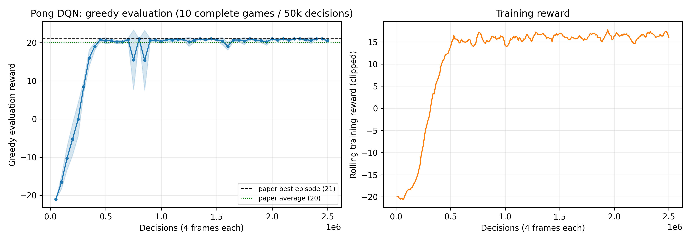

# DQN on Atari — from scratch

A from-scratch implementation of Deep Q-Networks (DQN) in PyTorch, applied to
Atari Pong and Breakout. The headline result is a paper-scale Pong run that
reaches the DQN paper's score: **21.0 greedy evaluation at ten checkpoints** and
a saved policy that wins **100/100 fresh-seed games 21–0**.

Full results and analysis: [`REPORT.md`](REPORT.md) ·
Requirement checklist: [`ASSIGNMENT_STATUS.md`](ASSIGNMENT_STATUS.md).



## Repository layout

```text
main.py                 Hydra training entry point
config/config.yaml      network, algorithm, environment and logging defaults
agent/                  Q-network agent, action selection, checkpoints
algorithm/              DQN update, target networks, exploration schedule
env/                    Atari wrappers and vector-environment factory
memory/                 circular experience replay
logger/, utils/         logging, evaluation, result and network utilities
tests/                  26 ROM-free regression tests
scripts/                pilot/long-run/analysis/verification drivers
kaggle/                 paper-scale run notebooks (Pong strict baseline, Breakout)
reports/                detailed reports, figures, raw CSV/JSON evidence
outputs/                local raw training runs (gitignored)
```

## Setup

The project uses Python 3.10+ (the provided `.venv` uses 3.12).

```bash
pip install -r requirements.txt
```

Atari ROMs must be available to ALE (for example `AutoROM --accept-license`).
The default game is `PongNoFrameskip-v4`; supported game IDs are listed in
`env/make_envs.py`. Device selection prefers CUDA, then Apple MPS, then CPU.

## Training

```bash
python main.py
```

A short run that exercises collection, learning and checkpoint writing:

```bash
python main.py total_epoch=3 interact_per_epoch=2 algorithm.buffer_size=16 \
  algorithm.batch_size=2 algorithm.learning_starts=0 test_interval=0 \
  train_log_interval=2 use_tensorboard=false
```

Useful overrides:

- `total_epoch` / `interact_per_epoch`: number of collect/update cycles and
  vector steps per cycle. `interaction_step` (transitions) drives logging,
  evaluation, saving and ε decay.
- `algorithm.learning_starts`, `algorithm.epsilon_timestep`,
  `algorithm.end_epsilon`: warmup and ε schedule.
- `algorithm.double_dqn` (default `false`): vanilla target-network DQN baseline;
  Double DQN is opt-in. `use_target=false` removes the target network entirely.
- `algorithm.architecture` (`paper2013` default, 16/32 conv + 256 hidden;
  `nature2015` 32/64/64 + 512), `activation` (`relu`/`leaky_relu`),
  `loss` (`mse`/`huber`), `optimizer`.
- `algorithm.action_selection` (`epsilon_greedy` default or `softmax`) and
  `algorithm.softmax_temperature`.
- `test_interval`, `test_episodes`, `save_interval`, `train_log_interval`;
  zero disables periodic triggering. A final checkpoint is always saved.
- `+save_pth=/path/model.pth` redirects the checkpoint (directory or filename).

Checkpoints store weights, spaces, architecture and activation. They do **not**
store replay, optimizer or RNG state, so training cannot be resumed exactly;
reproducibility depends on device and dependencies. `agent.load(path)` loads a
trusted checkpoint.

Replay stores explicit current/next observations (including terminal
observations), so memory is the binding constraint for long runs: about 56.4 KB
per transition for 4×84×84 uint8 observations (100k ≈ 5.65 GB, 250k ≈ 14.1 GB).

## Tests

```bash
python -m unittest discover -s tests -v
```

26 ROM-free tests cover replay overflow/successors, vector collection,
truncation masks, TD targets (vanilla and Double DQN), MSE update, target-copy
timing, normalization, checkpoint loading, evaluation cleanup, softmax
distributions, metrics and wrappers.

## Experiments and analysis

All drivers live in `scripts/` and are run from the repository root.

| Script | Purpose |
| --- | --- |
| `assignment_experiments.py` | four 20k-decision pilots (baseline, learning rate, ε decay, Breakout) |
| `long_experiments.py` | crash-safe long runs with incremental JSON, checkpoints, early stopping and final fresh-seed evaluation |
| `run_multiseed_batch.sh` | three tuning variants concurrently for one seed |
| `multiseed_analysis.py` | aggregate multi-seed runs into CSV/Markdown/PNG |
| `long_analysis.py` | plot a report, summarize throughput and memory projections |
| `kaggle_results_analysis.py` | parse a training log and independently evaluate a checkpoint on fresh seeds |
| `verify_long_run.py` | re-evaluate saved checkpoints on fresh reset seeds |
| `diagnose.py` | action frequencies, Q variability, activation sparsity and gradient probe |
| `checkpoint_sensitivity.py` | regional-occlusion / frame-order sensitivity report |
| `evaluate_assignment_results.py`, `plot_assignment_results.py` | pilot checkpoint evaluation and figures |
| `compare_dqn.py`, `compare_wrappers.py` | numerical learner parity against Stable-Baselines3 and wrapper comparison |

Example long run:

```bash
python scripts/long_experiments.py --tag pong-long --game PongNoFrameskip-v4 \
  --steps 1500000 --device mps --buffer-size 100000 \
  --epsilon-timestep 100000 --end-epsilon 0.01 \
  --target-update-interval 1000 --test-interval 50000
```

## Results

| Experiment | Budget | Outcome |
| --- | --- | --- |
| Short pilots (seed 0) | 20k decisions | all near random play; too noisy to rank |
| Multi-seed tuning | 3 variants × 3 seeds × 200k decisions | pilot ranking does not survive seed spread |
| Local long run | 1.25M decisions (5M frames) | −21 → best fresh-seed 20-game mean +4.3; below 21 |
| **Paper-scale Kaggle run** | **2.5M decisions (10M frames), 1 update/decision** | **21.0 at ten checkpoints; 100/100 fresh games 21–0** |

The paper-scale run used replay 200k, ε 1→0.1 over 250k decisions, target copy
every 1000 updates, Adam 1e-4, batch 32, and an 8 h 19 m Tesla T4 session. See
[`reports/03_pong21_2026-10-19.md`](reports/03_pong21_2026-10-19.md) for the
protocol, curve, verification and artifacts.

## Reports and evidence

| File | Contents |
| --- | --- |
| [`REPORT.md`](REPORT.md) | consolidated final report |
| [`reports/01_pilot_2026-10-18.md`](reports/01_pilot_2026-10-18.md) | 20k pilot design and initial reflection |
| [`reports/02_long_run_2026-10-18.md`](reports/02_long_run_2026-10-18.md) | long run, replay/update budget analysis, completion plan |
| [`reports/03_pong21_2026-10-19.md`](reports/03_pong21_2026-10-19.md) | paper-scale Pong 21 result and independent verification |
| [`reports/04_multiseed_2026-10-18.md`](reports/04_multiseed_2026-10-18.md) | 3×3 multi-seed tuning study |
| `reports/figures/`, `reports/data/`, `reports/verification/` | figures, raw CSVs and verification JSON |
| `reports/evidence/` | training logs, Kaggle notebook, per-run reports, solved checkpoint |

## Kaggle runbooks

- [`kaggle/pong_baseline_paper2013.ipynb`](kaggle/pong_baseline_paper2013.ipynb) —
  strict assignment baseline (paper2013/ReLU/MSE/vanilla) at the 2.5M-decision
  paper scale; this closes the configuration-compliance caveat.
- [`kaggle/breakout_paper2013.ipynb`](kaggle/breakout_paper2013.ipynb) —
  paper-scale Breakout (reference: 168 average / 225 best).

Both clone the GitHub repository, assert the current defaults, run the training,
verify the checkpoint and package artifacts. Push the current working tree
before running them.

## Caveats

- The 21.0 run was produced from the pre-baseline commit and therefore used
  `nature2015` + LeakyReLU + Huber + Double DQN. The repository now implements
  and defaults to the strict assignment baseline (paper2013 + ReLU + MSE +
  vanilla target DQN); a strict-baseline rerun notebook is provided but not yet
  executed. Do not attribute 21 to the strict baseline without that run.
- Paper-level Breakout has not been run at paper scale.
- The paper's full schedule (ten seeds per game) is a multi-day workload on this
  hardware; the measured budget analysis is in `reports/02_long_run_2026-10-18.md`.
